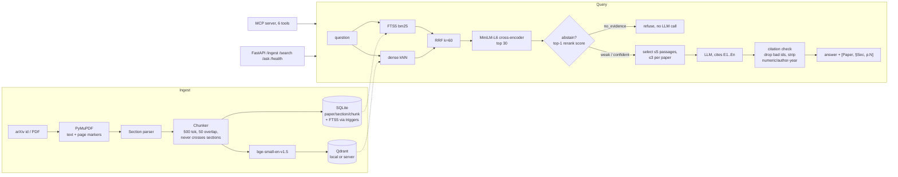

# scirag

[](https://github.com/K949406124/paper-rag/actions/workflows/ci.yml)

Question answering over arXiv papers. It uses hybrid retrieval (dense + BM25 + cross-encoder rerank), cites every claim as `[Paper, §Section, p.N]`, refuses when the evidence is weak, and keeps working when any one of its dependencies fails. Runs on CPU.

## Architecture



## Retrieval ablation

Labels are (paper, verbatim quote) pairs, so they don't depend on chunking. A retrieved chunk counts as a hit when it belongs to the right paper and contains the quote. See [How the evaluation works](#how-the-evaluation-works).

<!-- ablation:start -->
| Mode | Recall@5 | Recall@10 | MRR | nDCG@10 | p50 latency | p95 latency |
| --- | ---: | ---: | ---: | ---: | ---: | ---: |
| `dense` | 0.345 | 0.489 | 0.315 | 0.317 | 20 ms | 21 ms |
| `sparse` | 0.371 | 0.470 | 0.475 | 0.369 | 5 ms | 7 ms |
| `hybrid` | 0.432 | 0.576 | 0.422 | 0.407 | 24 ms | 27 ms |
| `hybrid_rerank` | 0.496 | 0.667 | 0.609 | 0.523 | 2542 ms | 2899 ms |

Recall@10, `hybrid_rerank` − `dense`: **+0.178** (paired bootstrap 95% CI [+0.102, +0.258], 1000 resamples over 44 questions).

44 answerable questions / 121 evidence quotes; corpus 31 papers / 797 chunks; embedding `BAAI/bge-small-en-v1.5`, reranker `cross-encoder/ms-marco-MiniLM-L-6-v2`, CPU. Source: `eval/results/ablation_2026-11-16.json`.
<!-- ablation:end -->

**A negative result worth keeping.** The plan capped hybrid results at 2 chunks per paper, for diversity. Measured, the cap hurt: most questions need 2–3 passages from the *same* paper, and the cap pushed them below rank 10. Retrieval now runs uncapped (`retrieve.max_per_paper: 0`), and diversity is enforced only when choosing the ≤5 passages for the LLM (max 3 per paper).

<!-- cap:start -->
| Mode | Recall@10, cap 2 per paper | Recall@10, no cap | nDCG@10, cap 2 | nDCG@10, no cap |
| --- | ---: | ---: | ---: | ---: |
| `hybrid` | 0.292 | 0.576 | 0.245 | 0.407 |
| `hybrid_rerank` | 0.402 | 0.667 | 0.375 | 0.523 |

Source: `eval/results/ablation_2026-11-16_cap2.json` vs `eval/results/ablation_2026-11-16.json`.
<!-- cap:end -->

## Answer quality: baseline vs full system

<!-- answer-eval:start -->
| Metric | A: baseline (no abstention, no citation check) | B: full system |
| --- | ---: | ---: |
| Citation existence rate (cited ids exist in the evidence given) | 100.0% | 100.0% |
| Citation precision (cited chunk contains a gold quote) | 38.6% | 38.4% |
| Abstention success (unanswerable questions refused) | 100.0% | 100.0% |
| False refusal (answerable questions refused) | 0.0% | 0.0% |
| Ungrounded answer rate (LLM judge: ≥1 unsupported sentence) | 8.3% | 11.7% |
| LLM calls made for the 15 unanswerable questions | 15 | 0 |

Sentences the judge left unlabelled (excluded, never counted as unsupported): A 0, B 0. 45 answerable + 15 unanswerable questions; generator `gpt-4o-mini`, judge `gpt-4o`. Source: `eval/results/answer_eval_2026-11-16.json`.
<!-- answer-eval:end -->

**How to read this.** On this question set the full system does **not** measurably beat the baseline on groundedness. Configurations A and B use the same retrieval and prompt for answerable questions, so the gap between their ungrounded rates is run-to-run noise. The strict prompt already makes `gpt-4o-mini` decline questions the evidence doesn't cover, and it never cited a passage it wasn't given, so the citation check had nothing to remove. What abstention *does* buy is skipping the LLM call on unanswerable questions, at no measured cost in false refusals. Citation precision is a strict measure: a cited chunk only counts if it contains one of the 1–3 labelled quotes.

<!-- answer-v1:start -->
First run (`eval/results/answer_eval_2026-11-16_v1_weakhint.json`): with a prompt hint on weak evidence, B wrongly refused 15.6% of answerable questions; the `gpt-4o-mini` judge rated almost every sentence supported. Both were fixed before the run above (hint removed; judge switched, refusal sentences post-checked); see `eval/judge_prompt.md`.
<!-- answer-v1:end -->

Abstention calibration:
<!-- abstain:start -->
Signal: top-1 reranker score (chosen over the alternative by leave-one-out). `threshold_low` = **0.045** (in-sample: refuses 100.0% of unanswerable, wrongly refuses 0.0% of answerable; leave-one-out: 100.0% / 0.0%). Source: `eval/results/abstain_calibration.json`.
<!-- abstain:end -->

## Quick start

```bash
python -m venv .venv && . .venv/bin/activate      # Windows: .venv\Scripts\activate
pip install torch --index-url https://download.pytorch.org/whl/cpu
pip install -e ".[models,dev]"
cp .env.example .env                               # add OPENAI_API_KEY (optional: retrieval works without it)

scirag ingest --file data/corpus.txt               # 31 papers, ~3 min on CPU after model download
scirag search "what are reflection tokens" --mode hybrid_rerank
scirag ask "How does Self-RAG decide when to retrieve?"
scirag serve                                       # http://127.0.0.1:8000/docs
scirag mcp                                         # MCP server on stdio
```

With Docker. Qdrant runs as a separate service, and the API reads `.env` for the LLM key. The image is ~2.5 GB because of CPU-only torch. Model weights are not baked in: they download on first start into a named volume.

```bash
make demo        # docker compose up, ingest 5 papers via the API, ask one question
```

Without `make` (e.g. Windows):

```bash
docker compose up -d --build
python scripts/demo.py
```

MCP client config:

```json
{"mcpServers": {"scirag": {"command": "scirag", "args": ["mcp"]}}}
```

Tools: `ingest_paper`, `list_papers`, `search_papers`, `ask_paper`, `get_section`, `delete_paper`. Arguments are pydantic models, and their JSON Schema is what `tools/list` returns. `ingest_paper` and `delete_paper` are refused unless `security.allow_writes: true`. `ingest_paper` only reads PDFs from `paths.pdf_dir` and rejects path traversal.

## Design decisions

**Hybrid retrieval.** Dense embeddings handle paraphrase ("when to retrieve" ≈ "on-demand retrieval"). BM25 handles exact tokens such as `IsRel`, `RAG-Token` and dataset names, which small embedding models blur. Neither alone wins on every question type, as the ablation table shows.

**RRF instead of score blending.** Cosine similarity and bm25 live on incomparable scales, and any weighted sum needs tuning per corpus. Reciprocal Rank Fusion (k=60) uses only ranks, has one robust parameter, and lets either side drop out cleanly when it fails.

**Cross-encoder rerank.** The bi-encoder and BM25 are fast but shallow. A cross-encoder reads the query and passage together and re-scores the top 30 fused candidates. The default is `cross-encoder/ms-marco-MiniLM-L-6-v2`: `BAAI/bge-reranker-base` took 21.5 s per query on this CPU against 1.4 s for MiniLM, measured on 30 real candidates. It can still be selected in `config/default.yaml`. Its sigmoid score is also the best signal we have for "is any of this actually relevant?", which drives abstention. (`bge-reranker-base` gave a 0.98 score to a flattened numeric table for "latest NVIDIA stock price"; MiniLM did not.)

**Abstention before generation.** If the top reranker score is below a threshold calibrated on the golden set (`scripts/calibrate_abstain.py`), the system refuses without calling the LLM. The refusal is then deterministic, and the call is never paid for. It does not depend on the LLM choosing to decline. With `gpt-4o-mini` and this prompt the model also declined by itself, so the measured gain here is cost and latency, not accuracy (see the table above). A middle "weak evidence" band still answers but returns `confidence: "low"`. An earlier version told the model in the prompt that the evidence was weak, and that made it refuse answerable questions (see the first-run note above). Leave-one-out numbers are reported next to the in-sample ones, because the thresholds are tuned on the same questions.

**Degradation over failure.** Each dependency has a fallback, and the response's `degraded` field says which one was used. Each fallback has a fault-injection test in `tests/test_fault_injection.py`:

| Failure | Behaviour | `degraded` |
| --- | --- | --- |
| Qdrant down | FTS5 only | `vector_store_unavailable` |
| Embedding model fails to load | FTS5 only | `embedding_unavailable` |
| FTS5 rejects the query | retry with sanitized barewords; if that fails too, dense only | `sparse_query_retried` / `sparse_unavailable` |
| Reranker fails | keep RRF order | `rerank_unavailable` |
| LLM timeout / error (2 retries) | return top passages with citations | `llm_unavailable` |
| Both retrievers return nothing | refuse | `no_results` |

## How the evaluation works

- `eval/source/qa_set.golden.jsonl` holds 60 questions (45 answerable, 15 unanswerable) about 6 papers. The corpus adds 25 RAG/retrieval papers as distractors (`data/corpus.txt`).
- `python -m scirag.eval.build_golden` re-labels each answerable question. It shows the LLM **all** chunks of the relevant papers, not only the ones our retriever finds, so the labels aren't biased toward our own system. The LLM picks 1–3 quotes (5–15 words) supporting the reference answer. A quote that isn't an exact substring is snapped to the most similar real window of the chunk it names, and kept only at ≥0.85 similarity, so every stored quote is verbatim source text. The output is `eval/golden.jsonl`, and every decision is logged in `eval/results/build_golden.log`.
- `python -m scirag.eval.run_ablation` reports Recall@5/10, MRR and nDCG@10 per mode, with p50/p95 latency measured after a warm-up query. It also reports a paired bootstrap 95% CI (1,000 resamples over questions) for the Recall@10 difference.
- `python scripts/calibrate_abstain.py --write-config` picks the abstention thresholds.
- `python -m scirag.eval.run_answer_eval` answers every question twice. Configuration A turns abstention and citation checking off; configuration B is the full system. An LLM judge labels each answer sentence as supported, unsupported or no-claim (rules in [`eval/judge_prompt.md`](eval/judge_prompt.md)). Ten random judgments go to [`eval/results/judge_spotcheck.md`](eval/results/judge_spotcheck.md) for manual checking.
- `python -m scirag.eval.report --readme` regenerates the tables above from `eval/results/*.json`. No number in this README is typed by hand.

**Caveats.**
- The set is small: 60 questions, written for the original 6 papers. CIs are wide.
- The same questions were used to calibrate the abstention thresholds, to pick the per-paper cap setting, and to fix the weak-evidence behaviour. Treat the results as dev-set numbers, not a held-out test.
- Quotes were picked by `gpt-4o-mini` and snapped to verbatim text automatically. A hand spot-check found most relevant, but some only loosely so. One question (g018) got no valid quote and is left out of the retrieval metrics.
- The judge (`gpt-4o`) comes from the same vendor as the generator (`gpt-4o-mini`).

## Tests

```bash
pytest -q                 # fast suite: hash embedder + lexical reranker fakes, no downloads
pytest -q -m slow         # real bge models
```

## Project layout

```
scirag/
  ingest/      arxiv.py  pdf_parser.py  pipeline.py
  chunk/       section_parser.py  chunker.py  models.py
  storage/     sqlite.py (+FTS5)  qdrant.py
  retrieval/   embedder.py  dense.py  sparse.py  rrf.py  hybrid.py  reranker.py  modes.py
  rag/         llm.py  prompts.py  evidence.py  citations.py  abstention.py  qa.py
  eval/        dataset.py  metrics.py  build_golden.py  run_ablation.py  run_answer_eval.py  report.py
  mcp/         server.py  tools.py
  api/         server.py
  service.py   cli.py  config.py  runtime.py
```

## Future work

- A larger, human-written question set with multiple annotators, and calibration on held-out questions.
- Better PDF parsing (layout models) for tables, equations and two-column edge cases; appendices whose headings don't say "Appendix" are currently dropped together with the references.
- Query rewriting / multi-hop retrieval for comparison questions that span several papers.
- An async ingest queue, and a streaming `/ask` endpoint.

## License

MIT (see `LICENSE`, kept from the earlier, larger project this code was distilled from).
